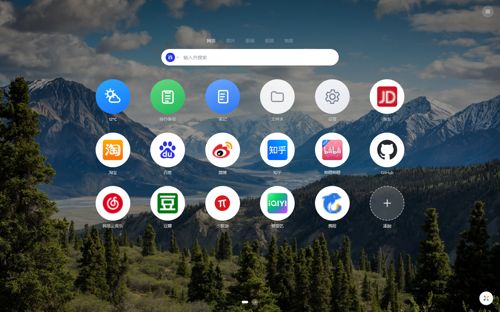
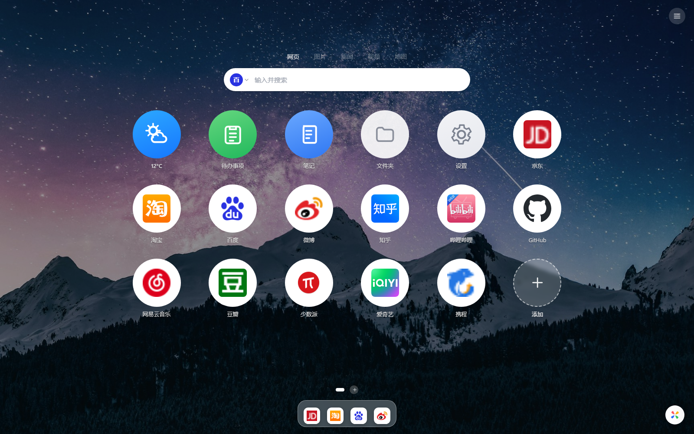

# TAB STUDIO

> Infinity 风格的新标签页扩展（Chrome Manifest V3），本地优先、无账号、无构建步骤。
> 当前版本 **v2.1.0**：右侧滑出面板 + 3×6 大圆图标 + 真实网站图标 + 高清壁纸库 + macOS 风格底部 Dock。

## ⬇️ 快速入口

| 用途 | 链接 |
|---|---|
| **下载安装包（推荐）** | **[tab-studio-v2.1.0.zip](https://github.com/compassscout/tab-studio/releases/download/v2.1.0/tab-studio-v2.1.0.zip)**（6.0 MB） |
| 在线主页 / 截图 | https://compassscout.github.io/tab-studio/ |
| 所有发布版本 | https://github.com/compassscout/tab-studio/releases |
| 当前版本发布页 | https://github.com/compassscout/tab-studio/releases/tag/v2.1.0 |
| 安装图文说明 | [安装说明.md](安装说明.md) |
| 问题反馈 | https://github.com/compassscout/tab-studio/issues |

> **安装三步**：下载 zip → 解压出 `tab-studio-v2.1.0` 文件夹 → 打开 `chrome://extensions`，开启「开发者模式」，点「加载已解压的扩展程序」，选择该文件夹。
> Chrome 不允许把 zip 直接拖进扩展页安装，这是浏览器限制。





## 功能

- **首页**：全屏摄影壁纸、居中搜索、3×6 大圆图标网格、分页圆点、彩色风车随机换壁纸
- **macOS 风格 Dock**：把网格图标拖到底部固定，拖出/右键移除，Dock 内拖拽排序，悬停放大 + 名称标签
- **真实网站图标**：在线图标源 → Chrome `_favicon` 本地缓存 → 首字色块，三级兜底
- **右侧面板**：添加 / 我的 / 设置三个 Tab，与原版 Infinity 同形态
- **壁纸库**：12 张内置 1920×1080 壁纸、收藏、仅收藏随机、上传压缩、必应每日、下载、定时轮换
- **小组件**：天气（Open-Meteo，可查城市）、待办（条目/勾选/角标/自动保存）、笔记（自动保存）、文件夹总览、设置
- **文件夹**：收纳站点、内部排序、编辑、打开全部、删除时释放站点
- **多分页**：新建/重命名/删除/拖拽排序，删除分页自动把内容迁到第 1 页
- **搜索**：百度 / Google / 必应 / Yahoo × 网页/图片/新闻/视频/地图，自定义搜索引擎，搜索建议（可选联网）
- **历史记录 / 书签**：可选权限，按需授权，不授权不影响其它功能
- **设置**：壁纸、打开方式、视图、布局、图标、搜索框、字体、动画、Dock、联网开关、还原
- **备份**：导出/导入 `.infinity`（单事务导入、结构校验、失败不覆盖）、修复数据
- **迁移**：首次启动自动读取旧版 `infinity_newtab` 数据与配置

## 安装

1. 打开 `chrome://extensions`，开启右上角「开发者模式」
2. 点「加载已解压的扩展程序」，选择本仓库根目录（含 `manifest.json`）
3. 新开标签页

> 扩展根目录下不要放以 `_` 开头的文件/目录（Chrome 保留名），否则会加载失败。

## 数据与权限

- 站点/文件夹/分页/壁纸/待办/笔记保存在本机 IndexedDB（`compass_newtab`），配置保存在 localStorage
- 权限：`storage`、`tabs`（添加当前页面）、`favicon`（本地图标缓存）
- 可选权限：`history`、`bookmarks`（首次打开面板时申请）
- 可选联网：必应壁纸、搜索建议、天气；可在「设置 → 通用」一键关闭
- 不上传任何数据，不需要账号

## 目录

```
manifest.json      MV3 清单
newtab.html        页面骨架 + SVG 图标 + 弹窗
css/               变量 / 基础 / 布局 / 组件 / 面板 / 设置
js/                ES Module：store / config / render / dock / panel / search /
                   wallpaper / folder / widgets / browserdata / contextmenu / drag …
images/wallpapers/ 12 张内置壁纸（Unsplash 免费许可）
icons/             16/32/48/128 图标
check_static.py    静态一致性检查
screenshots/       界面截图
交接文档.md         架构、数据模型、未完成项
安装说明.md         安装与常见问题
审计报告_v1.md      对旧版实现的审计与重做记录
```

## 自检

```bash
node --check js/*.js      # 各平台可循环执行
python check_static.py
```

期望输出：`全部通过：0 错误`。

## 说明

- 代码为独立实现，**未包含** Infinity 原版任何源码或素材；内置壁纸来自 Unsplash 免费许可图片。
- 云同步未接入，仓库只提供本地备份文件导入导出。
- 仅供个人学习与自用。
