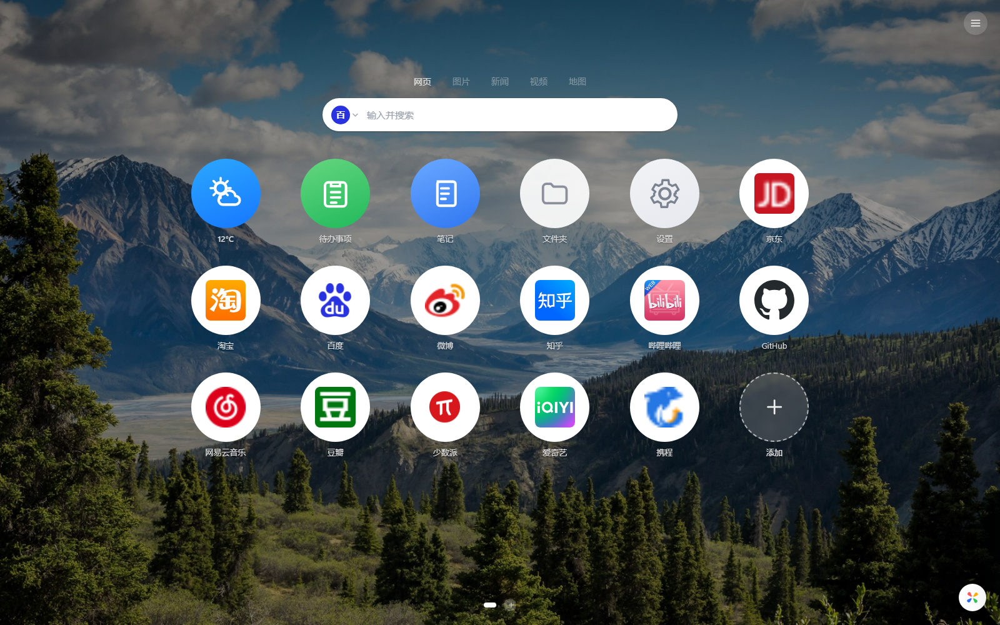
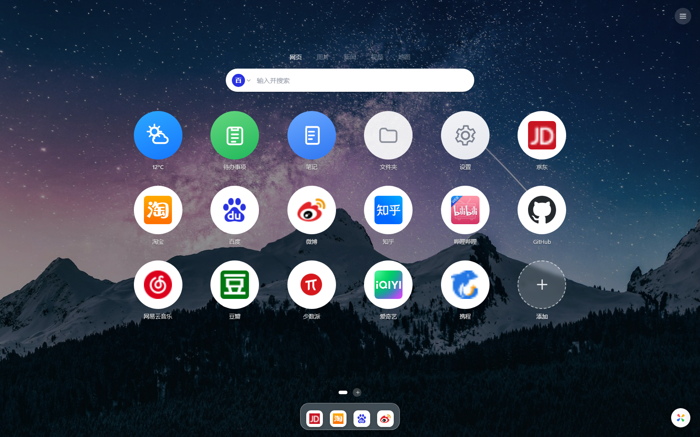

# TAB STUDIO

## 在线体验

> **网页版（最新代码，Cloudflare Pages）：[https://tab-studio.pages.dev/newtab.html](https://tab-studio.pages.dev/newtab.html)**
> 落地页 / 下载页：[https://tab-studio.pages.dev/](https://tab-studio.pages.dev/) ｜ 浏览器直接打开即可使用，不需要安装扩展。

> Infinity 风格的新标签页扩展（Chrome Manifest V3），本地优先、无账号、无构建步骤。
> 当前版本 **v2.2.1**：右侧滑出面板 + 3×6 大圆图标 + 真实网站图标 + 高清壁纸库 + macOS 风格底部 Dock。
> 最新已支持：**分页纯圆点循环翻页（对标 Infinity）**、**网页版浏览器直开即用**（无需安装扩展）、**Windows 桌面版（Electron）**。

## ⬇️ 三个版本，按需要挑一个

同一份源码，三种装法。功能一致，**数据各自独立**，可用「备份与恢复」互相导入导出。

| 版本 | 适合什么场景 | 下载 / 打开 | 说明 |
|---|---|---|---|
| **网页版** | 不想装任何东西、临时用、换电脑用 | 在线直接打开：[tab-studio.pages.dev/newtab.html](https://tab-studio.pages.dev/newtab.html)<br>离线包：[tab-studio-web-v2.2.0.zip](https://tab-studio.pages.dev/assets/tab-studio-web-v2.2.0.zip)（解压后需用本地 HTTP 服务打开，见包内 `网页版说明.txt`） | 数据存在浏览器 IndexedDB；读不到浏览器历史/书签 |
| **扩展版**（日常主力） | 想让它当 Chrome/Edge 的新标签页 | **Edge 商店一键安装：[TAB STUDIO — Microsoft Edge 加载项](https://microsoftedge.microsoft.com/addons/detail/tab-studio/jljjjpcgkhdejiijhcmlpeiodkbiepim)**（商店条目 ID `jljjjpcgkhdejiijhcmlpeiodkbiepim`）<br>Chrome / 手动安装：[tab-studio-extension-v2.2.0.zip](https://tab-studio.pages.dev/assets/tab-studio-extension-v2.2.0.zip) → 解压 → 加载已解压的扩展程序 | 可直接读浏览器历史/书签（可选授权）；新开标签页即生效。<br>注意：Edge 商店当前上架版本为 **2.1.0**，**v2.2.0 已提交审核**（审核通过后商店会自动更新）；想立刻用 2.2.0 请用下面的 zip |
| **桌面版**（Windows） | 想要独立窗口的 exe、不依赖浏览器扩展 | [TAB-STUDIO-2.2.0-x64.exe（安装版）](https://github.com/compassscout/tab-studio/releases/download/v2.2.0/TAB-STUDIO-2.2.0-x64.exe)<br>[TAB-STUDIO-2.2.0-portable.exe（免安装）](https://github.com/compassscout/tab-studio/releases/download/v2.2.0/TAB-STUDIO-2.2.0-portable.exe) | 独立窗口、源码可改、`Ctrl+R` 生效；另有源码包可在仓库 `启动.bat` 直接跑 |

> **扩展版安装三步**：下载 `tab-studio-extension-v2.2.0.zip` → 解压出 `tab-studio-extension-v2.2.0` 文件夹 → 打开 `chrome://extensions`，开启「开发者模式」，点「加载已解压的扩展程序」，选择该文件夹。
> Chrome 不允许把 zip 直接拖进扩展页安装，这是浏览器限制。
>
> **Edge 用户更省事**：直接在 [Microsoft Edge 加载项商店](https://microsoftedge.microsoft.com/addons/detail/tab-studio/jljjjpcgkhdejiijhcmlpeiodkbiepim) 点「获取」即可，不用开发者模式。商店版本随审核节奏走（当前 2.1.0，v2.2.0 审核中）。

## 其它入口

| 用途 | 链接 |
|---|---|
| **Edge 商店安装页（Microsoft Edge 加载项）** | **https://microsoftedge.microsoft.com/addons/detail/tab-studio/jljjjpcgkhdejiijhcmlpeiodkbiepim** |
| 在线落地页 / 截图 / 三个版本下载 | https://tab-studio.pages.dev/ |
| 所有发布版本 | https://github.com/compassscout/tab-studio/releases |
| 当前版本发布页 | https://github.com/compassscout/tab-studio/releases/tag/v2.2.0 |
| 旧站点（GitHub Pages，保留） | https://compassscout.github.io/tab-studio/ |
| 安装图文说明 | [安装说明.md](安装说明.md) |
| 问题反馈 | https://github.com/compassscout/tab-studio/issues |





## 2026-11-14 更新（v2.2.1）

本次只改「怎么把当前网页收进工作台」，数据格式、备份、配置项都没动，覆盖安装即可。

1. **工具栏图标左键直接弹「添加标签」面板**：停在任意网页，点一下扩展图标，就在该网页上浮出创建面板，预填网站名称、网址与图标文字——对齐 Infinity 的添加交互，不用先打开新标签页。
2. 面板字段：网站名称 / 网址（可改）· 选择图标（网站图标 / 纯色图标 / 本地图片上传）· 图标文字 · 字体大小（全局生效）· 颜色 · 确定 / 取消。点确定即写入工作台，面板自动关闭，已打开的新标签页会实时刷新。
3. 同一网址重复添加会提示「已经在工作台里了」，不会产生重复图标；当前页放满会自动顺延到后续分页，所有页都满则新建一页。
4. 记住上次浏览的分页：工具栏面板按你最后停留的那一页收藏，不再总是塞到第 1 页。
5. 书签 / 历史的可选权限入口移到面板底部折叠区，功能不变。
6. 桌面版 exe 仍为 v2.2.0 安装包（本次只动扩展源码，功能一致，无需重装）；扩展侧手动安装见 `dist/` 里的新 zip。

## 2026-11-11 更新（v2.2.0）

本次是一次集中的 bug 修复 + 桌面版落地，站点数据、备份格式、配置项均未变化，直接替换源码即可升级，数据不丢。逐条如下：

**数据与备份（防丢数据）**

1. 修复「导入备份」会清空壁纸的问题：`replaceAll` 现在只处理备份里**显式存在且为数组**的表，未提供的表保持原样；以前老备份没有 `wallpapers/todos/notes` 字段，导入时会被当成空数组整表清掉。
2. `importAll` 只覆盖备份内真实存在的表；备份缺 `pages` 时自动补一张首页；导入后按当前配置补回小组件槽位并重排，不再出现"导入后有站点但看不见"。
3. 修复「修复数据」会把小组件槽位全部删掉的严重问题：校验白名单加入 `WIDGET_IDS`，小组件不再被当作失效引用清理。
4. 「修复数据」增强：清理重复/悬空的图标引用、清理文件夹里指向已删除站点的成员，并把修正后的 `folders` 写回数据库；修复结果按条目汇总提示。
5. 删除分页时多个站点的 `pageId` 改为批量写入（`Promise.all`），减少逐条 await 造成的卡顿与半途失败。

**启动与分页布局（不再"自己乱动"）**

6. 启动只做「溢出顺延」不回收：新增 `reflowPages({ compact: false })`，手动拖到第 2/3 页的图标不会在下次打开时被拉回第 1 页，手动新建的空分页也不会被自动删除（导入/修复/删除分页仍走完整的回收模式）。
7. 修复窗口缩放/全屏切换后当前页"跑偏不居中"：resize 时把轨道位移重新吸附到 `-一个视口宽`，且翻页动画、手势拖动进行中不抢轨道。
8. 滚轮翻页到末页继续下滑改为循环回首页（与分页圆点一致），不再自动新建空分页。

**网站图标（弱网下也能加载出来）**

9. 修复在线图标并发名额泄漏：以前超时放弃的图标在排队轮到自己时仍占用名额且不归还，漏满 4 次后在线图标**永久不再加载**；现在释放幂等、只释放一次，超时/加载失败/页面已卸载都会正确归还名额。
10. 在线图标队列上限 64：网络很差时不再无限堆积请求，超出直接走首字色块兜底。
11. 新增 `resolveIcon` / `paintMiniIcon`：文件夹九宫格与 Dock 迷你图标改为**真实 favicon**（内置图标库 → 本地缓存 → 在线源 → Chrome 缓存），并与主网格共用解析缓存，已解析过的站点不再重复请求；单张探测 8s 兜底，不会永久挂起。

**文件夹**

12. 文件夹预览从 2×2 升级为 **3×3 九宫格真实图标**（主网格与 Dock 同步），成员上限 4 → 9。
13. 修复"编辑文件夹时点击站点会顺手打开网页"：编辑模式下点击只用于移出文件夹。
14. 在文件夹内新建站点不再占主页格子、也不会因为「当前页已满」而多建一个分页（`addSite` 新增 `placeOnPage: false`）。

**搜索**

15. 搜索引擎菜单改为 Infinity 风格 4 列图标网格：当前引擎高亮描边、自定义引擎右键即可删除、内置「添加」格子现场走添加流程并直接切换。
16. 修复搜索建议乱序：加入请求序号 `suggestSeq`，慢响应不会覆盖新输入的结果；收起建议时作废在途请求，弹窗关了不会被异步结果重新弹开。
17. 搜索引擎菜单增加右侧边界约束，不再溢出屏幕。

**界面**

18. 右上角按钮改为直接滑出右侧抽屉并落在新增的「快捷」页（Infinity 同款图块网格：添加站点 / 新建文件夹 / 壁纸库 / 添加网站 / 历史记录 / 书签），旧的顶部下拉菜单移除。
19. 修复壁纸收藏提示文案说反的问题（收藏/取消收藏现在对应正确）。
20. 「添加当前网页 / 添加站点」后的提示合并为一条，并明确写出「当前页已满，已顺延到后续页面」。

**桌面版（新）**

21. 新增 Electron 桌面壳：`desktop/main.js`（窗口、应用菜单、自定义协议、CORS）、`desktop/preload.js`（安全桥）、`package.json`（electron 33 + electron-builder 打包配置）、`启动.bat` / `打包.bat`、`桌面版说明.md`。同一份源码独立窗口运行，改完 `Ctrl+R` 即生效，可打包 nsis 安装版与 portable 免安装版。
22. 新增 `hasDesktop()` 判定；`openUrl` 在桌面壳内走应用窗口打开，并且只放行 `http(s):` / `mailto:` 地址，挡住 `javascript:` / `data:` 这类地址进入窗口或标签页。
23. 桌面版没有浏览器历史/书签：面板不再弹出"点了没反应"的授权按钮，改为明确说明（并提示需要时用扩展版），首次运行隐私提示文案同步按环境变化。
24. 桌面版「添加当前网页」改为取应用内最后打开的网页（`desktop.getLastPage`），没有则引导手动填写网址。
25. 桌面壳的下载完成提示与应用菜单快捷键（添加 / 设置 / 壁纸 / 新建文件夹 / 聚焦搜索）统一桥接到页面动作。

**其它**

26. 自检状态：`node --check` 全量 JS 通过，`python check_static.py` 输出「全部通过：0 错误」（manifest 1、HTML 1、CSS 6、JS 19、壁纸 12）。

## 功能

- **首页**：全屏摄影壁纸、居中搜索、3×6 大圆图标网格、分页圆点、彩色风车随机换壁纸
- **macOS 风格 Dock**：把网格图标拖到底部固定，拖出/右键移除，Dock 内拖拽排序，悬停放大 + 名称标签
- **真实网站图标**：在线图标源 → Chrome `_favicon` 本地缓存 → 首字色块，三级兜底
- **右侧面板**：添加 / 我的 / 设置三个 Tab，与原版 Infinity 同形态
- **壁纸库**：12 张内置 1920×1080 壁纸、收藏、仅收藏随机、上传压缩、必应每日、下载、定时轮换
- **小组件**：天气（Open-Meteo，可查城市）、待办（条目/勾选/角标/自动保存）、笔记（自动保存）、文件夹总览、设置
- **文件夹**：收纳站点、**3×3 真实图标九宫格预览**（与主网格共用图标解析缓存）、内部排序、编辑、打开全部、删除时释放站点
- **多分页**：纯小圆点、**循环翻页**（对标 Infinity：末页再向后回到首页、不自动新建空页）、新建/重命名/删除/拖拽排序，删除分页自动把内容迁到第 1 页
- **搜索**：百度 / Google / 必应 / Yahoo × 网页/图片/新闻/视频/地图，自定义搜索引擎，搜索建议（可选联网）
- **历史记录 / 书签**：可选权限，按需授权，不授权不影响其它功能
- **设置**：壁纸、打开方式、视图、布局、图标、搜索框、字体、动画、Dock、联网开关、还原
- **备份**：导出/导入 `.infinity`（单事务导入、结构校验、失败不覆盖）、修复数据
- **迁移**：首次启动自动读取旧版 `infinity_newtab` 数据与配置

## 网页版（无需安装）

工程内置了非扩展环境降级（`openUrl` / favicon / 添加当前页等自动走网页通道），因此**不装扩展也能用**：

- **在线网页版（Cloudflare Pages，最新代码）**：https://tab-studio.pages.dev/newtab.html （落地页 https://tab-studio.pages.dev/ ）
- 旧部署（GitHub Pages，保留兼容）：https://compassscout.github.io/tab-studio/newtab.html
- 本地也可直接打开仓库里的 `newtab.html`（或本地起 HTTP 服务访问）当网页版使用：搜索、图标、分页、壁纸、小组件齐全。
- 网页版数据与扩展各自独立（不同浏览器存储），默认是空、由你自行添加。
- **宣传 / 落地页**（GitHub Pages 部署）：https://compassscout.github.io/tab-studio/

## 桌面版（Windows，独立窗口）

源码自带一个 Electron 外壳，同一份界面可以直接当桌面应用跑，**保留源码、改完刷新即生效**：

```bash
双击 启动.bat          # 自动装依赖 → 开窗；之后每次直接启动
Ctrl+R                # 改完 js/css/html 立即重载
双击 打包.bat          # 生成 release/TAB-STUDIO-2.2.0-x64.exe 与 portable 免安装版
```

- 站点在应用内的独立窗口打开；「添加当前网页」取应用内最后打开的网页
- 桌面壳没有浏览器历史/书签，这两个面板会给出说明（需要时继续用扩展版）
- 桌面版与扩展版的数据各自独立，可用「备份与恢复」导出/导入互迁
- 细节见 [桌面版说明.md](桌面版说明.md)

## 安装

1. 打开 `chrome://extensions`，开启右上角「开发者模式」
2. 点「加载已解压的扩展程序」，选择本仓库根目录（含 `manifest.json`）
3. 新开标签页

> 扩展根目录下不要放以 `_` 开头的文件/目录（Chrome 保留名），否则会加载失败。

## 数据与权限

- 站点/文件夹/分页/壁纸/待办/笔记保存在本机 IndexedDB（`compass_newtab`），配置保存在 localStorage
- 权限：`storage`、`tabs`（添加当前页面）、`favicon`（本地图标缓存）
- 可选权限：`history`、`bookmarks`（首次打开面板时申请）
- 可选联网：必应壁纸、搜索建议、天气；可在「设置 → 通用」一键关闭
- 不上传任何数据，不需要账号

## 目录

```
manifest.json      MV3 清单
newtab.html        页面骨架 + SVG 图标 + 弹窗
css/               变量 / 基础 / 布局 / 组件 / 面板 / 设置
js/                ES Module：store / config / render / dock / panel / search /
                   wallpaper / folder / widgets / browserdata / contextmenu / drag …
desktop/           桌面壳：main.js（窗口/菜单/协议/CORS）、preload.js（桥）
package.json       桌面版依赖与 electron-builder 打包配置
启动.bat / 打包.bat  一键启动 / 一键打包 exe
images/wallpapers/ 12 张内置壁纸（Unsplash 免费许可）
icons/             16/32/48/128 图标
check_static.py    静态一致性检查
screenshots/       界面截图
交接文档.md         架构、数据模型、未完成项
安装说明.md         安装与常见问题
桌面版说明.md       桌面版启动、改源码、打包、与扩展版的差异
审计报告_v1.md      对旧版实现的审计与重做记录
```

## 自检

```bash
node --check js/*.js      # 各平台可循环执行
python check_static.py
```

期望输出：`全部通过：0 错误`。

## 说明

- 代码为独立实现，**未包含** Infinity 原版任何源码或素材；内置壁纸来自 Unsplash 免费许可图片。
- 云同步未接入，仓库只提供本地备份文件导入导出。
- 仅供个人学习与自用。
